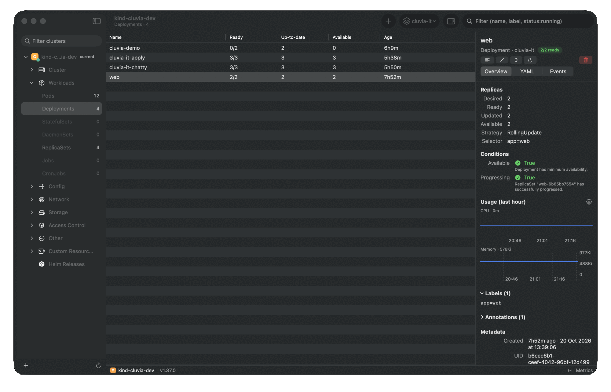
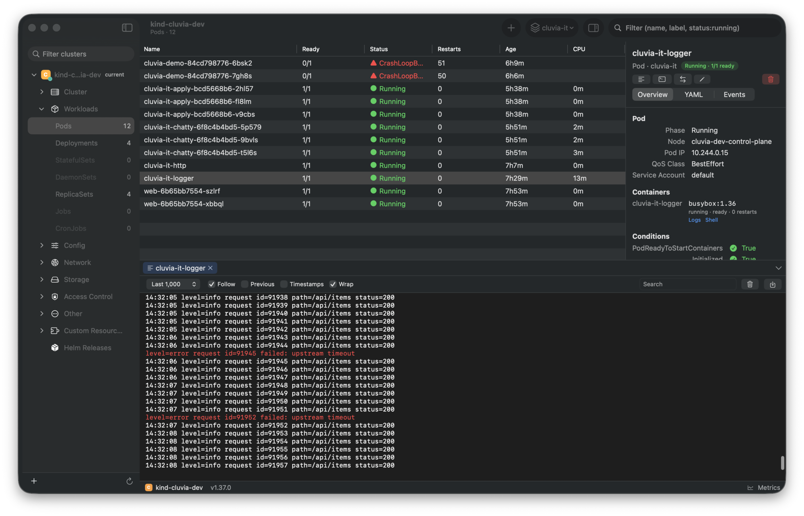

<p align="center">
  
  
</p>

<p align="center"><strong>A clear view of your Kubernetes world.</strong><br>
A fast, native <strong>Kubernetes GUI for macOS</strong> to explore, understand and manage your clusters:
browse resources and CRDs, stream pod logs, open shells, port-forward, edit YAML and kubeconfig, and manage Helm
releases.</p>

<p align="center">
  <a href="https://github.com/Eliitme/Cluvia/releases/latest"></a>
</p>

<p align="center">
  <a href="https://github.com/Eliitme/Cluvia/actions/workflows/ci.yml"></a>
  <a href="https://github.com/Eliitme/Cluvia/releases"></a>
  
  
  <a href="LICENSE"></a>
  <a href="https://scorecard.dev/viewer/?uri=github.com/Eliitme/Cluvia"></a>
  <a href="https://github.com/sponsors/Eliitme"></a>
</p>

<p align="center">
  
</p>

## Features

- **Native and light.** SwiftUI and AppKit, no Electron. Watches thousands of objects with a small memory footprint.
- **All your clusters in one sidebar.** Every context from your kubeconfig, grouped by file, with favorites,
  connection state and per-cluster color badges. Keep several clusters connected and switch instantly.
- **Live resource browser.** Every built-in kind and your CRDs, kept up to date with watches, with filters
  (`name`, `label=value`, `status:running`), namespace selection and CPU/memory columns from metrics-server.
- **Detail panel.** Status at a glance, conditions, containers, usage charts (from Prometheus), YAML and events.
- **Actions.** Logs (one pod or a whole workload), shell, port-forward, edit YAML with diff and dry run
  (server-side apply), scale, restart, cordon, drain, node shell and delete, each with a keyboard shortcut.
- **Built-in terminal and logs.** Shells and port-forwards run inside the app over the Kubernetes API:
  no `kubectl` required. Logs highlight errors and warnings.
- **Kubeconfig editing.** Add contexts by form, from a file or by pasting YAML; edit, rename, delete and set the
  current context. Edits go to the file that defines each entry, keep fields Cluvia does not know about, and save a
  backup first.
- **Helm.** Browse releases, values, manifests and history (needs the `helm` CLI).
- **Command palette** (⌘K) to jump to any kind, namespace, object or cluster.

<p align="center">
  
</p>

## Works with

Any conformant Kubernetes cluster your kubeconfig can reach: Amazon EKS, Google GKE, Azure AKS, DigitalOcean,
Rancher and k3s, kind, minikube, Docker Desktop, OpenShift and self-managed clusters. Authentication with client
certificates, tokens and credential plugins (`aws`, `gke-gcloud-auth-plugin`, `kubelogin`, OIDC helpers) works as in
`kubectl`.

## Install

Download the latest DMG from [Releases](https://github.com/Eliitme/Cluvia/releases) and drag Cluvia to
Applications. Requires macOS 14 or later.

- Cluvia reads your kubeconfig (`~/.kube/config` or the `KUBECONFIG` list, as `kubectl` does).
- Credential plugins (cloud CLIs, OIDC helpers) run from your login shell's `PATH`.
- `helm` is optional; without it the Helm section shows an install hint.
- CPU/memory columns need metrics-server; usage charts use an in-cluster Prometheus (detected, or set per cluster).

### About kubeconfig changes

Cluvia only writes to your kubeconfig when you add, edit, import or delete a context, or set the current context.
Before each write it takes the same lock as `kubectl`, refuses to overwrite a file that changed on disk, and keeps a
timestamped backup next to the file (`config.cluvia-backup-…`). Comments in the file are not preserved.

## FAQ

**Does Cluvia need kubectl?**
No. Cluvia talks to the Kubernetes API directly, including logs, shells (exec) and port-forwarding. Credential
plugins referenced by your kubeconfig still need to be installed.

**Is Cluvia free?**
Yes, for noncommercial use under the [PolyForm Noncommercial License](LICENSE). For commercial use, please
[get in touch](mailto:levanlong220700@gmail.com).

**Does Cluvia send my data anywhere?**
No. It connects only to your clusters (and Prometheus inside them for usage charts). There is no account, telemetry
or cloud service.

**Which macOS versions are supported?**
macOS 14 Sonoma and later, on Apple silicon and Intel.

**macOS says the app cannot be opened.**
Builds that are not yet notarized need a one-time approval: open **System Settings › Privacy & Security** and click
**Open Anyway** next to the Cluvia message.

## Build from source

```sh
brew install xcodegen
xcodebuild -downloadComponent MetalToolchain
xcodegen generate
open Cluvia.xcodeproj
```

See [CONTRIBUTING.md](CONTRIBUTING.md) for tests, project layout and release packaging.

## Contributing

Issues, ideas and pull requests are welcome. Please read the [contributing guide](CONTRIBUTING.md) and the
[code of conduct](CODE_OF_CONDUCT.md). Report security issues privately as described in [SECURITY.md](SECURITY.md).

Thanks to everyone who has contributed:

<a href="https://github.com/Eliitme/Cluvia/graphs/contributors">
  
</a>

## Support the project

Cluvia is built in spare time. If it saves you time, consider supporting its development:

- [GitHub Sponsors](https://github.com/sponsors/Eliitme)
- [Ko-fi](https://ko-fi.com/EliitmeVN)

## License

Cluvia is source-available under the [PolyForm Noncommercial License 1.0.0](LICENSE): you may use, study, modify
and share it for any noncommercial purpose. Commercial use requires a separate license; please
[get in touch](mailto:levanlong220700@gmail.com).

Brand assets (logo, icon) in `Brand/` identify the official project; please do not use them for forks or other
products. The wordmark is set in [Outfit](https://github.com/Outfitio/Outfit-Fonts) (SIL Open Font License 1.1).
